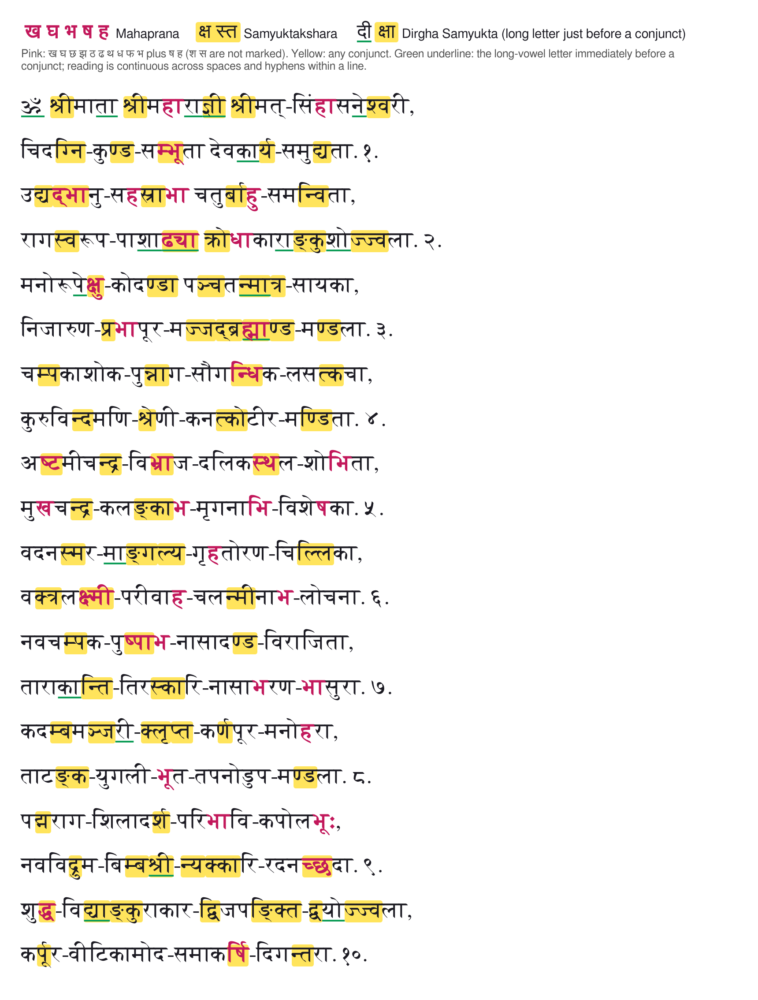

# Can a Language Model Help Apply Sanskrit Rules?

A practical experiment in using a language model to build a small tool for Sanskrit text, tested on the Lalita Sahasranama. Claude wrote the programs in this repo; the scripts apply the marking rules when run.

## Status: please read

**Experimental output — unverified.** The decoded Sanskrit text and marking conventions have not been reviewed by a Sanskrit teacher. Verify them before using the output as a pronunciation or chanting aid.

- The classifier has been tested only on this stotra and a short sample. Its behavior on other Unicode Devanagari text is untested. You are welcome to evaluate it locally and open an issue with failures.
- The output counts are not accuracy scores. A program can repeat an error consistently.
- The ten verses in the sample were decoded from a PDF whose edition is not identified, and have not been compared with a trusted edition. Treat them as illustrative.
- This experiment does not establish general Sanskrit proficiency or demonstrate improved pronunciation or chanting.

## Who this is for

This is for Sanskrit scholars, teachers, learners and readers interested in the language, as well as people researching or building language models and their applications. Sanskrit readers can examine the text and marking conventions; AI readers can examine how instructions became an executable tool and where errors or uncertainty entered the process. I asked Claude to turn an old-font PDF of the Lalita Sahasranama into color-marked Devanagari using three pronunciation-related rules I defined. The model recognized the text well enough to decode a legacy font that extracted as Latin-looking gibberish, then wrote the programs that decoded and marked the text.

## Why I ran this experiment
I wanted to explore whether a language model could help make language-specific rules visible and usable. Many languages carry information through pronunciation, spelling, grammatical structure and other conventions that a short translation or paraphrase may not capture. My working belief was that explicit rules, examples and tools could help make some of those features accessible. I wanted to investigate how that would work in practice.

The full write-up will be linked here when published on Substack.

## 1. What this demonstrates

**The problem.** Sanskrit pronunciation involves distinctions such as aspiration, vowel length and consonant clusters. This project highlights selected features using three marking conventions I defined. The intended use is a visual reading aid; improved pronunciation has not been evaluated.

**The question.** Could a model interpret the rules I supplied, translate them into a useful transformation, and preserve the original text? Where would it need correction? More broadly, how does a text-generating model work with linguistic features that require precise treatment?

I used the three language rules defined below, based on my understanding of Sanskrit grammar and language structure. There are many other rules that are not considered here. I used the Lalita Sahasranama as the Sanskrit text and applied the rules to it. The experiment covers source recovery and annotation only. It does not show general Sanskrit proficiency.

## 2. What is provided

**The code**, shared so others can read it, learn from the approach and test the idea. It is not open-source licensed; to reuse or build on it, please contact me (see License below).

| File | What it does |
|---|---|
| `src/marklib.py` | The classifier. Applies the three rules to Unicode Devanagari text. |
| `src/mark_text.py` | Command line tool: text file in, marked HTML (and optional PDF) out. |
| `src/decode.py`, `src/build_text.py` | Decoder for one specific legacy font ("Ancient Sanskrit 99") that turns `pdftotext` output into Unicode. Specific to that font; another PDF needs a new table. |
| `src/make_pdf.py`, `src/print_template.html` | Builds a paged PDF from a decoded text file. |

### The three rules

| Rule | What it marks | Color |
|---|---|---|
| Mahaprana | The aspirates ख घ छ झ ठ ढ थ ध फ भ, plus ष and ह (श and स are not marked). A conjunct containing one of these is colored as a whole unit to preserve its shaping; yellow highlighting can remain on that conjunct. | Pink, bold |
| Samyuktakshara | Any conjunct: two or more consonants joined, including reph forms | Yellow highlight |
| Dirgha Samyukta | The long-vowel-bearing unit immediately before a conjunct receives green underlining. The following conjunct retains its applicable yellow and pink markings. | Green underline |

The implementation assumes continuous reading: a long-vowel-bearing unit at the end of a word counts if the next word begins with a conjunct. This cross-boundary behavior needs review against the intended recitation practice. The pink group (ष and ह in addition to the ten aspirated stops) is the author's selected convention. Dirgha Samyukta is the author's label for the green-underlining rule described above.

## 3. Evidence

A snapshot only: the marked output for verses 1 to 10.

- `examples/verses_1-10_input.txt`: the ten verses as Unicode text
- `examples/verses_1-10_marked.html` and `.png`: the marked result
- `examples/sample_*`: a two-line test (the "sarve bhavantu sukhinah" verse)



The source PDF and the full decoded and marked files are intentionally not included. The examples allow inspection of the marking approach; they do not establish the fidelity of the full decoding process.

## Run it on your own text

```bash
pip install -r requirements.txt && playwright install chromium   # Chromium only needed for --pdf
python src/mark_text.py my_text.txt my_text_marked.html --pdf my_text_marked.pdf
```

Input must be Unicode Devanagari, one line of text per line. The FreeSerif and FreeSans fonts are used for rendering if installed.

## License

- **Code, sample marking and README:** Copyright (c) 2026 Yogesh Weling. All rights reserved; no open-source license is granted. You are welcome to read the code and run it locally to evaluate it. If you want to reuse, modify, redistribute or build on it, please get in touch first: open an issue on this repository or contact me through the Substack article once its link is added.
- **Sanskrit text:** the Lalita Sahasranama is a traditional text. No license is asserted over the verses in `examples/`; they are a small excerpt shown for demonstration, provided as-is. If you are a rights holder and want the excerpt credited differently or removed, please open an issue.
